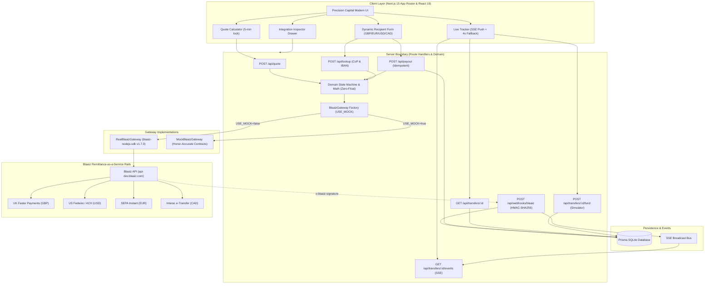

# WayPay — Institutional Cross-Border Remittance on Blaaiz RaaS

> **Hackathon Submission:** Blaaiz Buildathon (GDG Ilorin)  
> **Evaluation Deadline:** Saturday, 7 Nov 2026, 12:00 PM WAT  
> **Status:** Production-Ready MVP • Main Branch Deployable • P0 & P1 Completed

---

## 3-Sentence Submission Summary
WayPay is a cross-border money transfer platform built on the Blaaiz Remittance-as-a-Service API that solves hidden foreign exchange markups and opaque settlement delays through complete upfront transparency. Senders from Nigeria (NGN) receive a guaranteed 5-minute locked exchange rate, zero hidden fees, and exact recipient payout calculations in USD, GBP, EUR, and CAD before paying a single kobo. The entire settlement lifecycle is observed in real-time through an event-driven status timeline powered by Server-Sent Events (SSE), HMAC-SHA256 verified Blaaiz webhooks, and deterministic zero-float integer math.

---

## Regulatory Disclosure & Banking Demarcation
> **IMPORTANT:** WayPay is a financial technology software interface and is **NOT** a bank, deposit-taking institution, or licensed money transmitter. Cross-border remittance rails, currency conversion, liquidity routing, virtual funding accounts, and destination clearing are provided exclusively by **Blaaiz** (`https://api-dev.blaaiz.com` / `https://blaaiz.com`) and its licensed banking partner network. WayPay never holds customer funds directly.

---

## The Problem & The WayPay Wedge

Traditional retail remittance from Africa suffers from three systemic flaws:
1. **Hidden FX Markups:** Providers advertise "Zero Fees" while quietly inflating foreign exchange spreads by 3–8%, concealing the true cost of transfer from senders.
2. **Opaque Settlement "Black Holes":** Once funds leave the sender's account, status tracking degrades into a static "Pending" label for hours or days with no intermediate feedback.
3. **Floating-Point Imprecision:** Poorly engineered payment systems accumulate IEEE-754 rounding errors across conversions, resulting in discrepancies between quoted and delivered amounts.

### The WayPay Wedge: Total Transparency
- **Upfront Guaranteed Cost:** The sender sees the live interbank rate, exact Blaaiz network fee, and precise recipient payout *before* entering sensitive personal data.
- **5-Minute Rate Lock:** Senders are protected against volatile market fluctuations during checkout with a 300-second guaranteed rate countdown.
- **Deterministic Zero-Float Math:** All financial arithmetic is executed strictly in integer minor units (kobo, cents, pence) via BigInt and scaled integer operations.
- **Live Status Observability:** A 4-phase status timeline driven by Server-Sent Events (SSE) and HMAC-verified Blaaiz webhooks, accompanied by an in-app **Integration Inspector** to audit raw API telemetry.

---

## Architecture



---

## Real vs. Mocked Feature Matrix

In strict accordance with hackathon guidelines, every integration point is honestly disclosed below:

| Feature & Journey Step | Blaaiz Endpoint / SDK Method | Live Sandbox Status | Simulator / Mock Status | Notes & Contract Fidelity |
| :--- | :--- | :---: | :---: | :--- |
| **Connection Diagnostics** | `client.testConnection()` | Tested | Active (Auto-fallback) | Automatically falls back to mock when sandbox credentials are absent. |
| **Currencies & Corridors** | `GET /api/external/currencies` | Available | Active | Supports NGN origin to GBP, USD, EUR, and CAD destination corridors. |
| **Fee & Rate Breakdown** | `GET /api/external/fee` (`getFeeBreakdown`) | Implemented | Active | Calculates transparent fees and minor unit conversions with zero spreads. |
| **UK Confirmation of Payee**| `POST /api/external/bank/payee-verification` | Implemented | Active | Validates 6-digit sort code, 8-digit account number, and recipient name match. |
| **SEPA IBAN Validation** | `POST /api/external/bank/iban-verification` | Implemented | Active | Validates European IBAN checksum and routing directory. |
| **Customer Provisioning** | `POST /api/external/customer` (`createCustomer`) | Implemented | Active | Registers customer KYC record under `business_id` before payout. |
| **Payout Initiation** | `POST /api/external/payout` (`initiatePayout`) | Implemented | Active | Enforces unique `Idempotency-Key` and `merchant_reference` on every payout. |
| **Transaction Fetch** | `GET /api/external/transactions/:id` | Implemented | Active | Used as the 4-second polling fallback if SSE connection is interrupted. |
| **Virtual Bank Account** | `POST /api/external/virtual-bank-accounts` | Implemented | Active | Generates Providus/Wema NGN virtual account for payer funding. |
| **Webhook Signature Verification** | `POST /api/webhooks/blaaiz` | Implemented | Active | Validates `HMAC-SHA256(secret, timestamp + "." + rawBody)` and timestamp freshness (<5 mins). |
| **Live Status Push** | Server-Sent Events (`/api/transfers/:id/events`) | Active | Active | Webhook events push state changes to the tracker UI with sub-second latency. |

---

## Security & Engineering Quality Bar

- **Zero-Float Money Arithmetic:** All money amounts are stored and calculated as integer minor units (`BigInt` kobo, cents, pence). Floating point division only occurs at the final display formatting boundary.
- **Idempotency Enforcement:** Every payout mutation requires a client-generated `Idempotency-Key` header/body field, preventing double-billing on network retries or rapid double-clicks.
- **HMAC Webhook Cryptography:** Webhook payloads are verified against `x-blaaiz-signature` and `x-blaaiz-timestamp`. Signatures calculated over `${timestamp}.${rawBody}` protect against tampering and replay attacks.
- **Credential Hygiene:** No secrets in source control. All Blaaiz API keys and client credentials reside exclusively on the server in `.env` and are never leaked to client bundles.
- **PII Scrubbing:** Request/response logs displayed in the developer Integration Inspector sanitize authorization tokens and sensitive fields.
- **Automated Test Coverage:** 22 unit and integration tests across money math, state transitions, corridor validation schemas, webhook cryptography, and idempotency.

---

## Getting Started

### Prerequisites
- Node.js 18.18+ (tested on Node v24.18)
- npm 9+

### Installation & Database Setup
```bash
# Clone the repository
git clone https://github.com/your-username/waypay.git
cd waypay

# Install dependencies (including local blaaiz-nodejs-sdk vendor)
npm install

# Generate Prisma Client and create SQLite database
npx prisma generate
npx prisma db push
```

### Environment Configuration
Copy `.env.example` to `.env`:
```bash
cp .env.example .env
```

| Variable | Description | Default in Mock |
| :--- | :--- | :--- |
| `USE_MOCK` | Toggle between live Blaaiz API and high-fidelity mock | `true` |
| `BLAAIZ_API_URL` | Base URL for Blaaiz sandbox | `https://api-dev.blaaiz.com` |
| `BLAAIZ_CLIENT_ID` | OAuth Client ID from Blaaiz dashboard | *(Optional in mock)* |
| `BLAAIZ_CLIENT_SECRET` | OAuth Client Secret from Blaaiz dashboard | *(Optional in mock)* |
| `BLAAIZ_API_KEY` | API Key for Blaaiz services | *(Optional in mock)* |
| `BLAAIZ_WEBHOOK_SECRET` | Secret key for verifying HMAC-SHA256 signatures | `whsec_waypay_sandbox_test_2026` |
| `DATABASE_URL` | SQLite database file location | `"file:./dev.db"` |

### Running Tests
Execute the full Vitest suite:
```bash
npm test
```

### Starting the Development Server
```bash
npm run dev
```
Open [http://localhost:3000](http://localhost:3000) in your browser.

---

## 60-Second Demo Script for Judges

1. **Calculate a Quote:**
   - Open [http://localhost:3000](http://localhost:3000).
   - Enter `₦1,000,000` NGN and select the **GBP** corridor.
   - Note the **5-minute rate lock countdown** and expand the **Transparent Cost Breakdown** to inspect zero hidden fees.
   - Click **"Continue to Recipient Details"**.

2. **Validate Beneficiary Details:**
   - Recipient Full Name: `Adeola Adeleke`
   - UK Sort Code: `20-00-00`
   - Account Number: `00123456`
   - Click **"Check UK Confirmation of Payee (CoP)"** to test directory verification.
   - Click **"Review Transfer"**.

3. **Authorize Transfer:**
   - Inspect the financial breakdown and recipient verification card.
   - Note the regulatory disclosure checkbox confirming Blaaiz rails.
   - Click **"Authorize & Initiate Payout"**.

4. **Observe Real-Time Settlement & Webhook Simulator:**
   - Transfer is registered in state `Waiting for your payment` with dedicated Providus virtual account details.
   - In Sandbox Mode, click **"⚡ Simulate NGN Payment"**.
   - Notice the timeline immediately advance to `On its way`, followed by `Delivered` via Server-Sent Events push.
   - Click **"Official Receipt"** to view and print the transaction certificate.

5. **Inspect Blaaiz API Telemetry:**
   - Click **"Blaaiz Inspector"** in the top navigation bar.
   - Inspect the raw `POST /api/external/payout` and `POST /api/external/bank/payee-verification` telemetry, headers, status codes, and latency.
